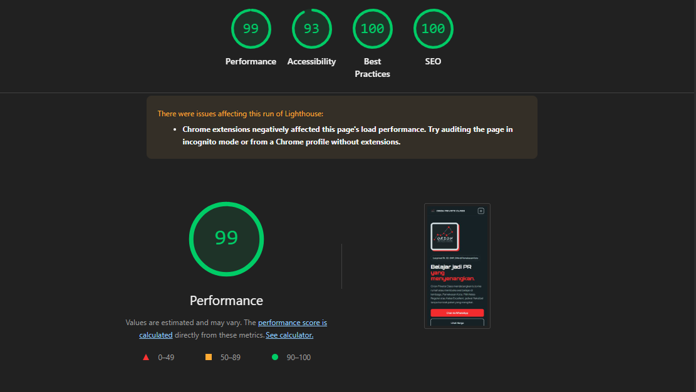

# Orion Private Class

Website landing page untuk **Orion Private Class**, layanan les privat TK, SD, SMP, dan SMA di Pamekasan Kota. Tersedia Kelas Reguler dan Kelas Excellent, dengan tutor datang ke rumah atau belajar langsung di lembaga.

🌐 **Live:** https://orionclass.netlify.app/

## Fitur

- Daftar harga lengkap (tutor ke rumah dan kelas di lembaga)
- Testimoni, profil singkat, area layanan dengan peta, dan FAQ
- Tombol chat WhatsApp
- Tampilan responsif (HP dan desktop) dengan menu navigasi mobile
- Satu file HTML statis, tanpa framework dan tanpa proses build

## Struktur Folder

```
.
├── index.html        # Halaman utama (HTML + CSS + JS dalam satu file)
├── image.jpg         # Logo (dipakai di navbar, hero, dan favicon)
├── og-image.jpg      # Gambar preview saat link dibagikan (1200x630)
├── robots.txt        # Aturan crawler dan lokasi sitemap
├── sitemap.xml       # Peta situs untuk Google
├── docs/
│   └── lighthouse.png  # Screenshot hasil Lighthouse (untuk README)
└── README.md
```

## Deploy

Website ini di-host di **Netlify** dan terhubung ke repo GitHub. Setiap push ke branch utama akan otomatis di-deploy ulang.

1. Push perubahan ke GitHub.
2. Tunggu status di tab **Deploys** Netlify berubah menjadi *Published*.
3. Buka website dan tekan `Ctrl + Shift + R` untuk melihat versi terbaru.

## Optimasi SEO

- Title, meta description, dan canonical URL ke `https://orionclass.netlify.app/`
- Open Graph dan Twitter Card untuk preview link di WhatsApp dan sosial media
- Structured data JSON-LD: `LocalBusiness` (dengan `AggregateOffer` untuk harga) dan `FAQPage`
- `robots.txt` dan `sitemap.xml` di root
- Struktur heading yang rapi (`h1` satu kali, `h2` per section)
- Atribut `width`/`height` pada gambar agar layout tidak bergeser saat loading
- Favicon dan `apple-touch-icon`

### Langkah setelah deploy

1. Tambahkan properti `orionclass.netlify.app` di [Google Search Console](https://search.google.com/search-console).
2. Submit `https://orionclass.netlify.app/sitemap.xml` di menu **Sitemaps**.
3. Gunakan **URL Inspection** lalu **Request Indexing** untuk halaman utama.
4. Daftarkan bisnis di Google Business Profile dan cantumkan link website.

## Hasil Pengujian Lighthouse

Pengujian dilakukan lewat Chrome DevTools (Lighthouse) pada tampilan mobile.



| Kategori | Skor | Artinya |
|---|---|---|
| **Performance** | 99 | Halaman sangat cepat dimuat. Hanya satu file HTML tanpa library berat, sehingga skornya nyaris sempurna. |
| **Accessibility** | 93 | Sudah baik. Masih ada sedikit ruang perbaikan, biasanya terkait kontras warna teks atau label elemen (detail ada di laporan Lighthouse). |
| **Best Practices** | 100 | Penerapan standar web modern sudah benar (HTTPS, tidak ada error di console, dsb). |
| **SEO** | 100 | Semua aspek dasar SEO terpenuhi: title, meta description, viewport, canonical, link yang bisa di-crawl, dan teks yang terbaca. |

### Catatan dari laporan

- Muncul peringatan **"Chrome extensions negatively affected this page's load performance"**. Artinya ekstensi Chrome yang terpasang ikut memengaruhi pengukuran, jadi skor Performance sebenarnya bisa sedikit berbeda. Untuk hasil yang lebih akurat, jalankan Lighthouse di **jendela incognito** atau profil Chrome tanpa ekstensi.
- Gambar di bagian kanan laporan adalah tangkapan layar halaman pada tampilan HP saat pengujian: logo Orion, judul *"Belajar jadi PR yang menyenangkan."*, deskripsi singkat, dan dua tombol (Chat via WhatsApp dan Lihat Harga).
- Skor Lighthouse mengukur aspek teknis. Posisi di hasil pencarian Google tetap bergantung pada konten, backlink, dan Google Business Profile.

## Cara Mengubah Konten

Semua konten ada di `index.html`:

- **Harga:** cari section `id="harga"` dan ubah nilai di `.price-row`.
- **Testimoni:** section `id="testimoni"`.
- **Nomor WhatsApp:** cari `wa.me/6281390308748` dan ganti nomornya.
- **Domain baru:** ganti `orionclass.netlify.app` di canonical, Open Graph, Twitter Card, JSON-LD, `robots.txt`, dan `sitemap.xml`.

## Kontak

WhatsApp: [wa.me/6281390308748](https://wa.me/6281390308748)
Jam layanan: Senin sampai Sabtu, 08.00 sampai 20.00 WIB

&copy; 2026 Orion Private Class
